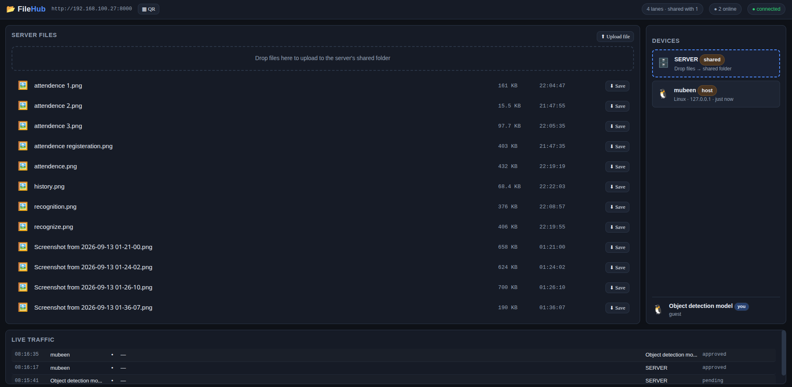

# FileHub

**AirDrop-style file sharing over a WiFi hotspot — a FastAPI server and a
browser. No app to install on the receiving side.**

FileHub turns any laptop (or an Android phone via Termux) into a tiny LAN
file hub. Devices join with a 6-digit code, the host approves them once,
and from then on everyone can upload to and download from a shared folder
and send files directly to each other — live, chunked, resumable, and
verified end-to-end.

## Features

- **Real-time dashboard** — every join, approval, upload, download and
  transfer updates every connected browser instantly over one WebSocket.
  No polling, no refresh.
- **Three-panel, role-aware UI** — Server Files, Devices, Live Traffic.
  The host sees extra controls (approvals, kick/block, delete, rotate code);
  guests never receive that data in the first place.
- **Uploads to the shared folder** — 1 MB chunks, parallel lanes, per-chunk
  CRC32, whole-file SHA-256, resume after a dropped connection, and
  targeted chunk repair if the hash ever mismatches.
- **Downloads with HTTP Range** — resumable, native browser downloads.
- **Device → device transfers** — relayed through the server in memory,
  forwarded chunk-by-chunk, never written to the server's disk.
- **Lane scheduler** — a global bandwidth budget shared fairly: 4 lanes per
  user at ≤3 users, down to 1 lane each at 11+ users, never above 18.
- **Hotspot-grade security** — join code + host approval + role checks on
  every privileged action, rate-limited join attempts, blocklist by device
  fingerprint (never by IP), optional trusted-device auto-approval.
- **QR code join** — terminal QR at startup and a QR button in the
  dashboard top bar.
- **Cross-platform, zero-install clients** — any modern browser on
  Android, iOS, Windows, macOS, Linux. Server runs on all of them too
  (Windows, macOS, Linux, Android/Termux).

## Screenshot



> *Placeholder* — the three-panel dashboard: Server Files (left),
> Devices (right), Live Traffic (bottom).

## Requirements

- Python **3.11+**
- A modern browser on the client devices (Chrome/Edge/Firefox/Safari,
  roughly 2021 or newer)
- Everything must be on the **same WiFi network** (a hotspot you control)
- ~10 MB of disk for the server itself (plus whatever you share)

## Installation

```bash
git clone https://github.com/BobiButt/Filehub.git
cd Filehub

python -m venv .venv
# Linux / macOS
source .venv/bin/activate
# Windows (PowerShell)
# .venv\Scripts\Activate.ps1

pip install -r requirements.txt
```

## Quick start

### 1. Start a WiFi hotspot

- **Android**: *Settings → Network & hotspot → Hotspot & tethering →
  WiFi hotspot* — set a strong password (it is your first security layer).
- **iOS**: *Settings → Personal Hotspot → Allow Others to Join*.
- **Windows**: *Settings → Network & Internet → Mobile hotspot*.
- **macOS**: *System Settings → General → Sharing → Internet Sharing*
  (share your connection over WiFi).

Connect the other devices to that hotspot.

### 2. Run the server

```bash
python run.py
```

The terminal prints:

```
==============================================================
  FileHub — LAN file transfer hub
==============================================================
  Open in a browser : http://192.168.43.1:8000/
  Local only        : http://127.0.0.1:8000/
  Join code         : 482913
  Host admin URL    : http://192.168.43.1:8000/?admin=<32-char-token>
  Shared folder     : /path/to/FileHub/shared
  ...
==============================================================
  Scan to join (same WiFi/hotspot required):
  [QR code]
```

| Line | Meaning |
| --- | --- |
| **Open in a browser** | The URL everyone (including you) opens. |
| **Local only** | Loopback URL — opening it makes that browser the **host**. |
| **Join code** | 6 digits guests type to join. Rotatable from the host UI. |
| **Host admin URL** | Open once to grant *this* browser host rights from another device (sets an HttpOnly admin cookie, then redirects). |
| **QR** | Scan with a phone camera to jump straight to the URL. |

### 3. Open the dashboard as host

Open the **Local only** URL (or the admin URL) on the machine running the
server. You get the full dashboard with the **Pending Approval** section.

## Usage

### Uploading to the server

- Drag files onto the **drop zone** (or anywhere in the Server Files
  panel), or onto the **SERVER** card in the Devices panel, or click
  **⬆ Upload file**.
- The browser hashes the file (SHA-256, in a Web Worker), splits it into
  1 MB chunks and streams them over your lane allotment.
- Progress appears in Panel 1 and in the Live Traffic log for everyone.
- If the connection drops: the page retries automatically; on reload,
  re-pick the file and only the missing chunks are sent.

### Downloading from the server

- Click any file row (or **⬇ Save**). Small files use the browser's native
  downloader (Range/resume included); large files stream with a progress
  bar.
- Downloads show up in the Live Traffic panel for every dashboard.

### Sending to another device

- **Drag a file onto another device's card** in Panel 2.
- The other device gets an *“X wants to send …”* modal with
  **Accept / Decline**.
- On accept, chunks stream live over the WebSocket relay; all dashboards
  watch the progress. The receiver verifies CRC32 per chunk and the whole
  file's SHA-256, then saves it (streamed to disk where the browser
  supports the File System Access API, otherwise buffered and downloaded).

### Host controls

| Control | Where | Effect |
| --- | --- | --- |
| Approve / Reject | Pending Approval card | Lets a device in, or turns it away |
| Kick | Device card | Removes it now; it may rejoin (trusted → auto-approved) |
| Block | Device card | Removes it and bans its fingerprint permanently |
| 🗑 Delete | File row | Deletes from the shared folder for everyone |
| ⟳ Rotate | Top bar | Invalidates the old join code instantly |

## Configuration

All knobs live in `app/config.py` (`ServerConfig`, pydantic-settings).
Any field can be overridden with an environment variable or a `.env` file
in the project root (e.g. `PORT=9000 python run.py`).

| Field | Default | Meaning |
| --- | --- | --- |
| `host` / `port` | `0.0.0.0` / `8000` | Bind address. LAN only — do not expose to the internet. |
| `shared_dir` / `tmp_dir` / `sessions_dir` | `./shared` `./tmp` `./sessions` | The public folder, in-progress uploads, upload manifests. |
| `chunk_size` | `1_048_576` (1 MB) | Transfer chunk size (server-authoritative). |
| `max_file_size` | 20 GB | Rejects larger uploads/offers. |
| `global_lane_budget` | `18` | Hard cap on parallel streams across all devices. |
| `per_user_lanes_small/medium/large/max` | `4/3/2/1` | Per-user lanes for 1–3 / 4–6 / 7–10 / 11+ users. |
| `join_code_length` | `6` | Digits in the join code. |
| `join_code_expires_hours` | `0` | 0 = never expires (host rotates manually). |
| `wrong_code_attempts_before_cooldown` / `cooldown_seconds` | `3` / `30` | Rate limit: 3 wrong → 30 s, then 5 min, then a session block. |
| `require_host_approval` | `True` | Every new device waits for the host. |
| `auto_approve_first_n` | `0` | Auto-approve the first N guests (0 = approve all manually). |
| `heartbeat_interval_seconds` / `heartbeat_timeout_seconds` | `20` / `60` | Server ping cadence / when to drop a silent device. |
| `persist_trusted_devices` | `True` | Remember approved fingerprints in SQLite (`trusted_devices.db`). |
| `log_ips` | `False` | IPs are RAM-only either way; this stays off. |

## Security notes

Security is layered, in order:

1. **Hotspot password (WPA2/WPA3)** — your responsibility. FileHub
   assumes the LAN itself is closed; pick a strong hotspot password.
2. **Join code** — 6 digits, printed at startup, shown only to the host,
   rotatable any time from the top bar.
3. **Host approval** — every new device sits in *Pending Approval* until
   you click ✓ (unless `auto_approve_first_n` says otherwise).
4. **Role enforcement** — approve/kick/block/delete/rotate are checked on
   the server on every request. Hiding buttons in JS is UX, not security:
   a forged request from a guest gets **403**.

Additional rules FileHub follows:

- **Never trust the client.** Device ids, roles and file paths are all
  server-generated or server-validated.
- **Host role = localhost or the admin token.** The printed admin URL
  sets an HttpOnly admin cookie on first use and redirects; it is
  separate from the guest session cookie.
- **Rate-limited join attempts** — 3 wrong codes → 30 s cooldown → 5 min →
  session block.
- **Block by fingerprint** (UA + language + screen + timezone), not by IP.
- **No IP persistence.** IPs exist only in RAM for the session; nothing
  IP-related is ever written to disk.
- **No internet exposure.** Bind `0.0.0.0` for the LAN; do not port-forward.
- **No self-signed HTTPS in v1** — the WPA2 hotspot already isolates
  client traffic, and a self-signed certificate only adds friction.
- **No E2E encryption in v1** — relays are integrity-checked (CRC32 +
  SHA-256) but not encrypted end-to-end. A future optional mode can add it.

The optional `trusted_devices.db` (SQLite, project root) stores only
`fingerprint, name, added_at` — never IPs — so approved devices skip
approval on their next join.

## Troubleshooting

**A device can't reach the server**
- Confirm every device is on the *same* hotspot/WiFi (not guest network,
  not VPN).
- Check the firewall: allow inbound TCP `8000` (or your `PORT`) on the
  machine running the server.
  - Linux: `sudo firewall-cmd --add-port=8000/tcp` (or `ufw allow 8000`).
  - macOS: *System Settings → Network → Firewall* — allow Python.
  - Windows: allow Python in *Windows Defender Firewall* on Private networks.
- Use exactly the URL printed by `python run.py` — a wrong IP is the
  most common failure.

**The approval panel doesn't appear (or approvals do nothing)**
- Only the **host** sees it. Make sure that browser opened the *Local
  only* URL or the printed **Host admin URL** (which sets the admin
  cookie), then joined/loaded the dashboard from there.
- Guests correctly get 403 if they try — that is the server enforcing
  roles, not a bug.

**Transfers are slow**
- WiFi hotspots cap total throughput; client↔client relays cross the air
  twice, so ~half of a direct upload's speed is normal.
- Too many parallel streams? The scheduler already caps them, but 2.4 GHz
  channels are crowded — move the hotspot to 5 GHz if you can, or reduce
  `global_lane_budget`.
- Microwaves and walls matter more than software on a hotspot.

**A guest is stuck "waiting for approval"**
- Approve them from the host's Pending Approval list. If the host page
  looks frozen, refresh it — the host is a browser tab like any other.

**An upload failed / WiFi dropped**
- Just reload the page and pick the file again: FileHub resumes from the
  server's bitmap and only resends missing chunks. If the whole-file hash
  mismatches, the client automatically repairs only the bad chunks.

**"Blocked" after testing too many codes**
- Wrong codes are rate-limited (3 → 30 s → 5 min → session block) per
  fingerprint. Restart the server to clear in-RAM attempt state; a host
  *Block* is permanent in `trusted_devices.db` (delete that file to undo).

**Port already in use**
- `PORT=8001 python run.py`, or stop the other process.

## Architecture overview

```
Browser (vanilla JS, one WebSocket)          FastAPI server
┌──────────────────────────────┐            ┌─────────────────────────────┐
│ panel_files   panel_devices  │  WS /ws    │ connection_manager — sockets│
│ panel_traffic approval       │◄──────────►│ hub        — devices/state  │
│ uploader / downloader        │            │ broadcaster — live events   │
│ sender / receiver (relay)    │            │ security    — code/roles    │
│ ws.js store + reconnect      │            │ relay       — chunk forward │
└──────────────────────────────┘            │ upload_session — resume     │
        │ HTTP (Range, multipart)           │ lane_scheduler — fairness   │
        └──────────────────────────────────►│ file_manager  — shared/     │
                                            └─────────────────────────────┘
```

Module responsibilities mirror the design document (§9):

| Module | Responsibility |
| --- | --- |
| `app/core/hub.py` | Single source of truth: devices, transfers, traffic (RAM), join code, admin token, role-filtered snapshots |
| `app/core/connection_manager.py` | Live sockets, broadcast, byte sends, heartbeat pings |
| `app/core/broadcaster.py` | Typed WS events with the right audience (pending devices never receive member events) |
| `app/core/file_manager.py` | `shared/` listing, path sanitization, unique names, delete |
| `app/core/upload_session.py` | Chunk manifests + hex bitmaps in `sessions/`, offset writes in `tmp/`, SHA-256 finalize |
| `app/core/relay.py` | Offer → accept → forward (CRC-verified, verbatim) → finish/abort; never touches disk |
| `app/core/lane_scheduler.py` | Global budget + per-user lane table |
| `app/core/security.py` | Join codes, admin token, fingerprinting, rate limits, SQLite trusted/blocked lists |
| `app/api/*` | HTTP + WebSocket endpoints (§8 of the design) |
| `app/static/js/*` | One WS client, three panels, uploader/downloader/sender/receiver |

Transfers: uploads are HTTP chunked (1 MB, CRC32 per chunk, SHA-256 per
file, resumable via bitmap); downloads are HTTP Range; device→device is a
binary WebSocket relay — the server parses the header, verifies CRC32 and
forwards the frame verbatim without ever buffering a whole file.

## Limitations

- **iOS Safari cannot stream relay to disk** — without the File System
  Access API the receiver buffers in memory and downloads a Blob at the
  end (a warning is shown for large files).
- **Client→client halves throughput** — relayed data crosses the air
  twice (A→server, server→B), so expect roughly half of a direct upload's
  speed.
- **WiFi hotspot caps total throughput** — FileHub can't exceed what the
  radio gives it; the lane scheduler only divides it fairly.
- **No E2E encryption in v1** — integrity is verified, confidentiality
  relies on the WPA2/WPA3 hotspot.
- **Relay transfers are RAM-only on the server** — a server restart
  mid-relay aborts them (uploads *do* survive restarts and can resume).
- **One socket per device** — a second tab on the same browser session
  takes over the connection.

## License

MIT License — see [LICENSE](LICENSE). Copyright year 2026.

Prefer another license? Replace the `LICENSE` file with GPL-3.0
(`https://www.gnu.org/licenses/gpl-3.0.txt`) or Apache-2.0
(`https://www.apache.org/licenses/LICENSE-2.0.txt`) text and update this
section — no code changes are required.

## Credits

- **FastAPI** & **Starlette** — web framework, WebSockets, file responses
- **uvicorn** — ASGI server (websockets backend for binary frames)
- **pydantic** / **pydantic-settings** — models and configuration
- **aiofiles**, **python-multipart**, **Jinja2** — async file I/O, uploads, templating
- **qrcode** — terminal and dashboard QR codes
- The SHA-256 and CRC32 implementations in `app/static/js/util.js` are
  self-contained (public-domain algorithm) because `crypto.subtle` is
  unavailable on insecure LAN origins.
